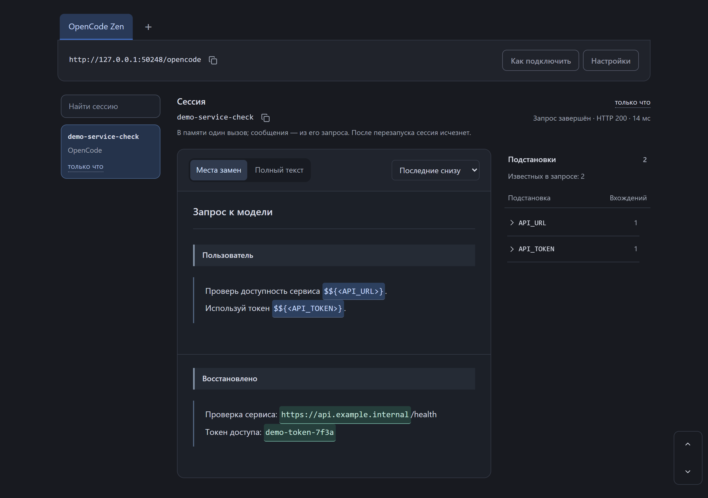

<h1 align="center">GhostVault</h1>

<p align="center"><strong>Контролируйте, что получает ваша AI-модель.</strong></p>

<p align="center">
  <a href="#как-это-выглядит">Как это выглядит</a> ·
  <a href="#возможности">Возможности</a> ·
  <a href="#установка-и-запуск">Установка</a>
</p>

GhostVault — локальный шлюз и хранилище переменных для работы с AI. Скрывайте пароли, токены и внутренние адреса, предоставляйте агентам нужные переменные и проверяйте, что получает модель.

## Как это выглядит

Вместо внутреннего адреса сервиса модель видит его обозначение:

| Этап | Содержимое |
|---|---|
| Ваш запрос | Проверь `https://api.example.internal/health` |
| Запрос к модели | Проверь `$${<API_URL>}/health` |



*Интерфейс на демонстрационных данных.*

## Возможности

- **Свои правила защиты.** Добавляйте секреты вручную или включайте автоматическое обнаружение. Проверяйте действие правил на текущих запросах и закрепляйте найденные значения под понятными именами.
- **Переменные для AI-агентов.** Через MCP агент получает каталог имён, обозначений и описаний без раскрытия значений. Например, он может найти `API_URL` и `API_TOKEN` для задачи. Каталог можно запросить повторно, если переменные изменились.
- **Обновление секретов под прежним именем.** Меняйте пароль, токен доступа или адрес сервиса, сохраняя обозначение переменной. Доступны редактирование описаний, переименование и копирование; переименование меняет обозначение и требует обновить старые ссылки.
- **Просмотр обеих сторон обмена.** Сравнивайте запрос к модели и ответ приложению, смотрите места замен с соседними строками или полный текст. Есть простой и расширенный режимы; в расширенном ответ виден по мере поступления.
- **Общее хранилище для нескольких клиентов.** AI-клиенты подключаются к одному локальному серверу. Настроенное MCP-подключение запускает его при первом обращении; в Windows можно включить запуск при входе в систему.
- **Последний вызов каждой сессии.** Его контекст доступен в памяти до перезапуска или удаления сессии. Новые вызовы не накапливаются в дисковой истории; прежние данные старых версий автоматически не удаляются.
- **Настройки под свой процесс.** Управляйте подключениями и экспортируйте выбранные настройки. JavaScript-хуки позволяют расширять обработку запросов и ответов.

Поддерживаются форматы OpenAI Chat Completions и Responses, Anthropic Messages, Gemini и обёртка Antigravity. Для MCP есть настройка подключений Codex, Claude и Cursor.

**Статус: в разработке.** Маскирование действует в поддерживаемых полях запросов. Локальное хранилище секретов пока не зашифровано.

## Установка и запуск

Нужны Node.js 22.13+, npm и Git. Соберите текущую версию в npm-архив и установите CLI:

```sh
git clone https://github.com/damix96/ghost-vault.git
cd ghost-vault/ghostvault
npm run setup:dev
npm pack
npm install --global ./ghostvault-0.1.0.tgz
ghostvault start
```

`npm pack` включает сборку приложения. Если готовый архив уже есть, достаточно последних двух команд.

Откройте [панель управления](http://127.0.0.1:8765/dashboard), добавьте подключение и следуйте инструкции «Как подключить». Состояние сервера показывает `ghostvault status`, остановка — `ghostvault stop`.

### Подключение MCP

Выведите конфигурацию для своего клиента:

```sh
ghostvault setup --client codex
```

Вместо `codex` можно указать `claude` или `cursor`. Добавьте полученную конфигурацию в настройки MCP клиента. Для записи в файл используйте `--config <путь>`; перед изменением существующего файла создаётся резервная копия. Подключение MCP предоставляет каталог переменных; запросы к модели нужно отдельно направить через GhostVault по инструкции в панели.

### Автозапуск и демо

В Windows команда `ghostvault setup --autostart --apply` включает запуск при входе пользователя. Для Linux и macOS доступны запуск вручную и запуск через MCP; настройка системного автозапуска пока не реализована.

Для знакомства без внешних API-ключей выполните `npm run demo` из каталога `ghostvault` после сборки. [Демонстрационный стенд](http://127.0.0.1:8766/dashboard) работает с имитацией модели и отдельной базой в памяти.
