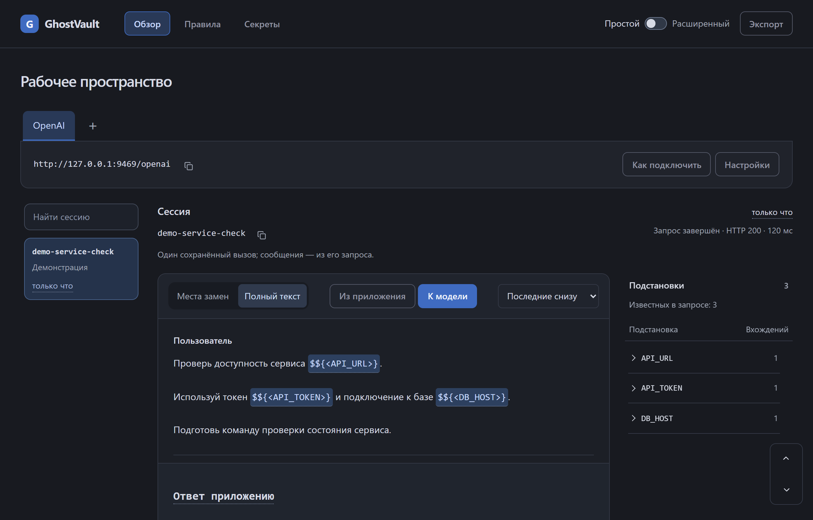

<h1 align="center">GhostVault</h1>

<p align="center"><strong>Контролируйте, что получает ваша AI-модель.</strong></p>

<p align="center">
  <a href="#как-это-выглядит">Как это выглядит</a> ·
  <a href="#попробовать">Попробовать</a>
</p>

GhostVault — локальный шлюз для защиты секретов при работе с AI. Вы выбираете, какие данные скрывать, и видите, что получает модель.

## Как это выглядит

Например, вместо внутреннего адреса сервиса модель видит его обозначение:

| Этап | Содержимое |
|---|---|
| Ваш запрос | Проверь `https://api.example.internal/health` |
| Запрос к модели | Проверь `$${<API_URL>}/health` |

## Видно, что уходит в модель



*Настоящий интерфейс на демонстрационных данных.*

- **Свои правила.** Добавляйте секреты вручную или включайте автоматическое обнаружение.
- **Проверяемые замены.** Сравнивайте исходный запрос с тем, что отправлено модели, в одном интерфейсе.
- **Привычные инструменты.** Работайте с AI-клиентами, использующими форматы OpenAI, Anthropic и Gemini.

## Попробовать

Нужны Node.js 22.13+ и npm. Из корня репозитория:

```sh
cd ghostvault
npm run setup
npm run build
npm run demo
```

Откройте [демонстрационный стенд](http://127.0.0.1:8766/dashboard). Внешние API-ключи не нужны: вместо облачной модели используется имитация.

Для своего провайдера запустите `npm start`, откройте [панель подключений](http://127.0.0.1:8765/dashboard) и следуйте инструкции «Как подключить».

**Статус: в разработке.** Маскирование действует в поддерживаемых полях запросов. Локальная база пока не зашифрована и может содержать секреты и историю запросов.
